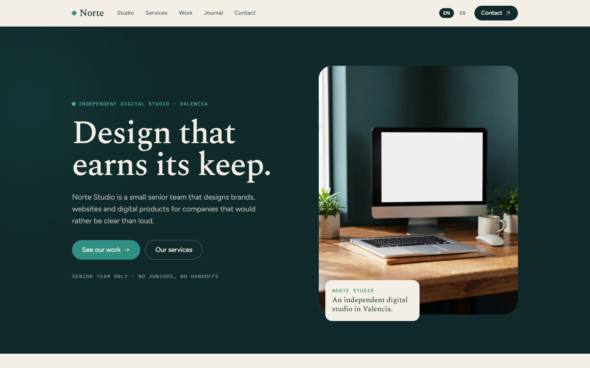

# Norte Studio

A bilingual marketing site for a fictional independent digital studio in Valencia: strategy, brand, web and product design.



## What it is

Norte Studio is a front-end reference implementation of a digital-agency site. It ships a homepage, studio, services, work (with per-case detail pages), journal (with per-article pages) and a contact page, fully translated into English and Spanish.

It is a demo, not a product: every client, case study, article, person and metric is fictional, and the contact form only acknowledges a submission — there is no backend, database or mail path.

## Why this over a generic agency template

- **Bilingual by default.** Two typed dictionaries, `/[locale]` routes, automatic browser-language detection, a manual switcher, localized dates and prices, and `hreflang` alternates.
- **No remote assets.** Fonts are bundled at build time and every image is a local SVG, so the site renders without third-party requests.
- **Small dependency surface.** Next.js, React and Tailwind CSS. No component kit, no animation library, no state manager.
- **Content as data.** Case studies and articles live in `src/content`, so list and detail pages stay in sync and adding an item is a single typed edit.
- **Accessibility baseline.** Skip link, labelled navigation and controls, semantic landmarks, visible focus states and a keyboard-usable mobile menu.

## Quick start

Requirements: Node.js 24 (see `.nvmrc`) and pnpm 11.

```bash
git clone https://github.com/JORDANROBERTO74/norte-studio.git
cd norte-studio
pnpm install
pnpm dev
```

Open <http://localhost:3000>. The root redirects to `/en` or `/es` based on your browser's `Accept-Language`, and remembers an explicit choice in a cookie.

| Command | What it does |
| --- | --- |
| `pnpm dev` | Start the development server on port 3000 |
| `pnpm build` | Create an optimized production build |
| `pnpm start` | Serve the production build |
| `pnpm lint` | Run ESLint |
| `pnpm typecheck` | Run `tsc --noEmit` |

## Internationalization

Copy lives in `src/i18n/dictionaries/en.ts` and `es.ts`. The English file defines the `Dictionary` type, so a missing or misspelled key in Spanish fails `pnpm typecheck` instead of rendering a blank label.

- `src/i18n/config.ts` lists the supported locales and the cookie name.
- `src/proxy.ts` detects the locale and redirects `/` to `/{locale}`.
- `src/lib/format.ts` centralizes `Intl` formatting for dates and prices.
- Adding a locale means adding it to `locales`, creating a dictionary that satisfies `Dictionary`, and updating `localeNames`.

## Project structure

```text
src/
  app/
    [locale]/          # layout, homepage, subpages, 404, OG image
      about/           # studio
      services/        # services + plans + process
      work/            # case study list
      work/[slug]/     # case study detail
      journal/         # article list
      journal/[slug]/  # article detail
      contact/         # contact form
    globals.css        # Tailwind theme tokens
    robots.ts
    sitemap.ts
  components/          # home, layout, shared and ui components
  config/              # site metadata and market settings
  content/             # case studies, articles, team
  i18n/                # locale config, dictionaries, lookup
  lib/                 # formatting, metadata, class names
  proxy.ts             # locale detection
public/
  images/              # self-hosted abstract artwork
```

## Configuration

The only environment variable is `NEXT_PUBLIC_SITE_URL`, used for canonical URLs, `hreflang`, Open Graph and the sitemap. When it is unset, the app falls back to `https://norte-studio.vercel.app`.

```bash
NEXT_PUBLIC_SITE_URL=https://your-domain.com
```

## Deployment

The app deploys to Vercel with the default Next.js preset:

1. Import the repository.
2. Keep the Node.js 24.x runtime.
3. Set `NEXT_PUBLIC_SITE_URL` to the production origin.
4. Deploy.

Live demo: <https://norte-studio.vercel.app>

## Status and scope

This is a portfolio reference implementation, maintained but not production-ready. There is no backend, persistence or mail path; the sample content is intentionally static and fictional. Verification covers `pnpm lint`, `pnpm typecheck`, `pnpm build` and a manual pass over both locales at desktop and mobile widths.

## License

Proprietary, all rights reserved. See [LICENSE](LICENSE). Third-party dependencies remain under their own licenses.
